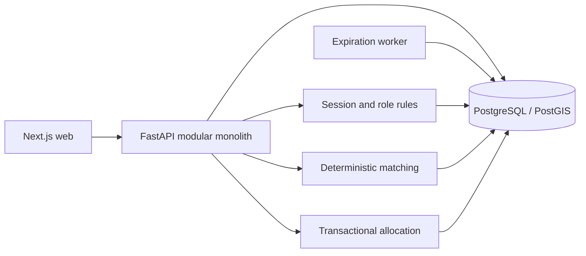

# ReliefGrid

**Intelligent emergency resource coordination.** ReliefGrid helps a supply organization publish available stock and a response organization reserve matching resources, dispatch them and confirm delivery in one auditable workflow.

This portfolio project emphasizes transaction safety, relational modeling and explainable operations. The repository contains a runnable FastAPI + Next.js modular monolith backed by PostgreSQL/PostGIS. It is intended for a local synthetic demonstration; it is not certified for live emergency response.

## Why it exists

Emergency stock often sits in separate spreadsheets and message threads. A warehouse may have surplus water while a shelter cannot see it. ReliefGrid puts locations, resource lots, urgent needs, allocation decisions and shipment events into one consistent data model.

Target users: inventory managers, request coordinators, dispatchers, organization administrators and auditors. A platform administrator flag is present in the data model; administrative platform operations are not exposed in the UI.

## What the prototype does

- Register an organization, sign in with Argon2id, rotate/revoke a database-backed session, enforce roles and organization membership.
- Record geographic facilities, lot quantities, reserved balances and expiration dates. Numeric quantities are exact to 0.001 of a resource's stated unit.
- Submit, verify and match requests. Deterministic scores explain urgency, distance, quantity coverage, expiration and deadline components.
- Reserve stock inside a PostgreSQL transaction with request/lot locks, conditional updates and idempotency. Database checks prevent a negative or over-reserved lot.
- Prepare, pick up, dispatch and deliver shipments; update inventory and request state; inspect an organization-scoped audit trail.
- View operational metrics, resource flow and a Leaflet/OpenStreetMap map of supply, demand and active shipment paths.
- Query paginated inventory, requests and audit events. Location search uses PostGIS radius filtering.

## Five-minute demo

1. Sign in as `inventory@reliefgrid.local`. Inspect North Jakarta stock; receive a new lot if desired. Sign out.
2. Sign in as `coordinator@reliefgrid.local`. Create a critical request at Pluit Emergency Shelter. Submit and verify it, then run matching.
3. Inspect the score breakdown and reserve enough stock to fill the request. Sign out.
4. Sign in as `dispatcher@reliefgrid.local`. Prepare a shipment for the allocation, record pickup and dispatch. Sign out.
5. Sign in as `coordinator@reliefgrid.local`. Confirm delivery with a synthetic recipient name. Inspect the dashboard and request status. Sign in as `auditor@reliefgrid.local` to inspect the audit trail.

All seeded accounts use `DEMO_PASSWORD` from the local `.env` file. No password is embedded in frontend code or source-controlled seed files.

## Architecture



The backend groups core transaction, auth, domain and schema rules in `apps/api/reliefgrid`. PostgreSQL is the sole operational source of truth. A small database-backed worker expires overdue unallocated requests; no cache or queue is required. See [architecture decisions](docs/architecture/ADR-001-modular-monolith.md), [ERD](docs/database/README.md) and [data dictionary](docs/database/data-dictionary.md).

## Database engineering

- Normalized organizations, memberships, locations, resources, inventory lots, requests/items, allocations and shipments; immutable status and audit event tables. No universal soft delete.
- PostGIS `geography(Point,4326)` and GiST index for geospatial searches; FEFO index for available lots; composite and partial indexes for operational queues.
- Atomic reservation: lock the request/item, lock the chosen lot, validate eligibility and outstanding demand, conditionally increase `reserved`, persist allocation and audit in a single transaction.
- Unique `(request_item_id,lot_id)`, idempotency keys scoped to actor/operation and DB quantity checks protect retries and races. Recompute eligibility at allocation time because recommendations are snapshots.

```mermaid
sequenceDiagram
    participant C as Coordinator
    participant A as API
    participant P as PostgreSQL
    C->>A: Reserve item/lot + idempotency key
    A->>P: Begin; advisory key lock
    A->>P: Lock request, then lot
    A->>P: Validate demand, eligibility, available stock
    A->>P: Conditional reserved update; allocation; audit
    P-->>A: Commit or conflict
    A-->>C: Allocation ID or stable error code
```

The DB trigger rejects audit updates/deletes. The application user does not own the schema or have audit update/delete privileges. See [security model](SECURITY.md).

## Local setup

Requirements: Docker Engine with Compose v2, Make, and ports 3000, 8000, 5432 available. Run from repository root:

```bash
cp .env.example .env
# Change local passwords in .env before use; keep the URL passwords in sync.
make up
```

Open [web UI](http://localhost:3000), [API docs](http://localhost:8000/docs), [health](http://localhost:8000/health) and [readiness](http://localhost:8000/ready). `make up` builds containers, starts the database, applies versioned migrations and inserts synthetic demo data. The development seed is repeatable. `make down` preserves data; `make reset` removes the local database volume and all local data.

Environment variables in `.env.example`:

| Variable | Purpose |
| --- | --- |
| `POSTGRES_DB`, `POSTGRES_USER`, `POSTGRES_PASSWORD` | Local database and schema-owner credential |
| `POSTGRES_APP_PASSWORD` | Dedicated runtime role credential, initialized on first database boot |
| `MIGRATION_DATABASE_URL` | Schema-owner connection used only by Alembic and local benchmark |
| `DATABASE_URL` | Limited application-role connection |
| `WEB_ORIGIN`, `NEXT_PUBLIC_API_URL` | Allowed browser origin and public API URL |
| `SECURE_COOKIES` | Set true behind HTTPS |
| `SESSION_HOURS` | Session expiration period |
| `DEMO_SEED`, `DEMO_PASSWORD` | Explicit synthetic seed gate and demo credential |

If changing database passwords after initialization, remove the local volume with `make reset` or alter the database roles manually. Never use example credentials in a deployed environment.

### Windows PowerShell quick start

Extract the ZIP first and open PowerShell in the extracted `reliefgrid` folder (the one containing `compose.yaml`). Install and start Docker Desktop with its WSL 2 backend, then run:

```powershell
Copy-Item .env.example .env
notepad .env
# Save local passwords in .env; update both database URLs if you change the corresponding passwords.
docker compose up --build -d db
docker compose run --build --rm api alembic upgrade head
docker compose up --build -d api worker web
docker compose exec -T api python -m reliefgrid.seed
docker compose ps
```

Open `http://localhost:3000` and sign in as `coordinator@reliefgrid.local` with the password in `DEMO_PASSWORD`. The first build may take several minutes. If a command fails, run `docker compose logs --tail=100 db api web worker` and inspect the first error. To run the database and web checks after startup, use `docker compose -f compose.yaml -f compose.test.yaml run --build --rm test-api` and the equivalent `test-web` command.

## Developer commands

| Command | Action |
| --- | --- |
| `make up` | Build, start, migrate and seed local demo |
| `make migrate` / `make seed` | Apply migrations / repeat synthetic seed |
| `make test` | Real PostgreSQL/PostGIS API tests and web build/component checks |
| `make lint` / `make typecheck` | Python and TypeScript quality checks (local dependencies required) |
| `make build` | Build production container images |
| `make benchmark` | Run rollback-only synthetic EXPLAIN benchmark; print JSON |
| `make backup` / `make restore FILE=backups/reliefgrid.dump` | Local binary backup / restore |
| `make reset` | Destroy local volumes and rebuild demo data |

Browser tests require a running demo stack:

```bash
cd tests/e2e
npm ci
npx playwright install chromium
npm test
```

The CI workflow runs migrations, database integration tests, lint, type checks, production web build, dependency audits, Playwright and health/readiness checks. Tests require a real PostgreSQL/PostGIS server; SQLite is not a substitute.

## Matching explanation

Eligibility is a hard gate: same resource, active supplier, publicly shared inventory or same organization, positive available quantity, expiry on/after the required date, and within the selected radius. The score is `urgency (0–25) + distance (0–20) + coverage (0–30) + expiry (0–15) + deadline (0–10)`. Distance decays exponentially with a 100 km scale. Coverage is capped at the requested amount. FEFO is applied in initial candidate retrieval and as a score tie breaker among usable lots. Recommendations save the components; allocation rechecks the current database state. See [formula and trade-offs](docs/architecture/ADR-002-matching.md).

## Benchmark methodology

`make benchmark` inserts 2,500 synthetic locations, 30,000 lots, 12,000 requests and 12,000 audit records inside a rollback-only transaction. It runs `EXPLAIN (ANALYZE, BUFFERS, FORMAT JSON)` for nearest-location, urgent-request and expiring-inventory queries before and after creating their indexes. It prints measured plans, timings and block counts as JSON. Run it on an isolated local database; cache warmth and laptop hardware affect timings. **No measured result is included in this repository because this environment did not have a PostgreSQL/PostGIS runtime.** The harness is in `apps/api/reliefgrid/benchmark.py`.

## Current verification and limits

Python syntax, Ruff, mypy, OpenAPI generation, web lint, TypeScript checks, component tests and a production web build were run during creation. On 2026-11-06, an embedded PGlite database with its PostGIS extension passed a migration upgrade/downgrade/upgrade round trip and 10 API/domain/seed tests, including role and tenant boundaries, spatial queries, idempotency and full delivery. Eight database tests also passed after explicitly switching connections to the limited `reliefgrid_app` role; this exposed and resolved a missing row-lock permission. PGlite's socket server multiplexes a single database connection: a simultaneous allocation test returned a connection error, so this result cannot establish PostgreSQL race behavior. Docker/PostgreSQL integration, native concurrency, browser journey and benchmark still require the local/CI stack before claiming deployment readiness. The repository contains no verified screenshots; add a screenshot from a running browser after those checks. The local dependency audit found no known Python or production npm vulnerabilities; eight moderate findings remain in the development ESLint toolchain. There is no outbound notification channel or uploaded delivery evidence, no external messaging integration, and no platform administration UI. The map and operational lists use bounded queries; advanced text search and fleet routing are outside this prototype.

## Roadmap

1. Complete verified container and browser test run; capture real UI screenshots and record actual benchmark plans.
2. Add expiring-lot notices and an outbound notification channel to the existing worker.
3. Add organization invitation/activation and finer permission boundaries.
4. Add signed delivery evidence upload and stronger tamper-evident audit export.

See [API examples](docs/api/examples.md), [operations runbook](docs/operations/runbook.md), [backup guide](docs/operations/backup-restore.md), [contributing](CONTRIBUTING.md) and [license](LICENSE).
