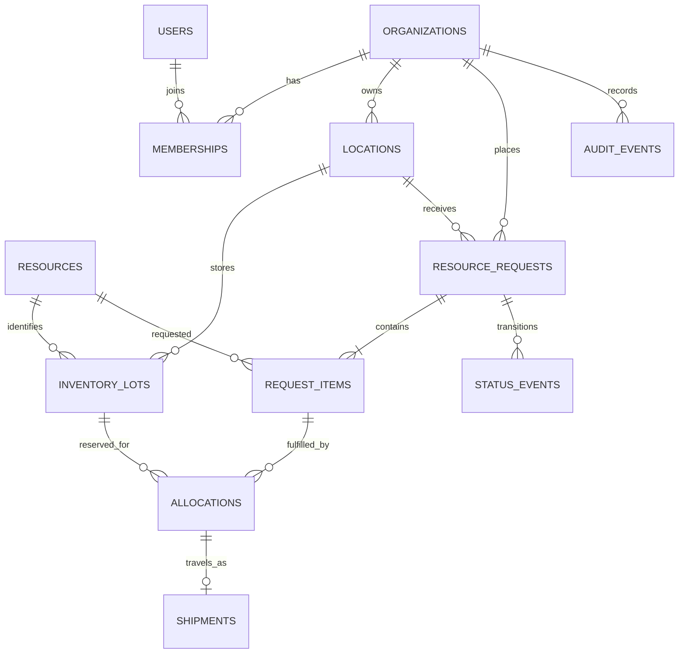

# Database design

## Conceptual model

Organizations operate locations and have users via memberships. Resources are defined in exact units. An inventory lot belongs to one source location; a request belongs to one destination and contains one or more resource items. Allocations join request items to lots. Each allocation can have one shipment. Status events describe request transitions, and audit events record important changes.

## Logical ERD

## Physical invariants and indexes

`numeric(16,3)` stores quantities; `CHECK (on_hand >= 0 AND reserved BETWEEN 0 AND on_hand)` guards lots, and `CHECK (quantity > 0)` guards requests and allocations. Foreign keys express ownership and item/lot relationships; composite `(location_id, organization_id)` ensures a lot belongs to a location of its own organization. Unique `(request_item_id,lot_id)` merges repeated reservations into one allocation. Expiration is nullable for durable supplies; FEFO order puts null last.

`locations.position` is PostGIS geography with GiST for radius/nearest searches. Partial `lots_fefo_idx` covers available stock ordered by resource and expiry. `requests_queue_idx` covers active request queues; `requests_search_idx` supports PostgreSQL full-text search over reason and notes. `audit_org_idx` supports descending organization audit lookup. `lots_org_idx` and `requests_recent_idx` support stable `(created_at,id)` cursor pages. See migration `0001_initial.py` for exact DDL and [dictionary](data-dictionary.md).

Normal form: organization/location/resource facts live in their own tables; memberships resolve many-to-many users and organizations; request items and allocations split repeating groups. `reserved` is a deliberate derived balance maintained in the same transaction as allocations for a constant-time stock check. An external operation must never modify allocations or inventory rows directly outside the API transaction.
